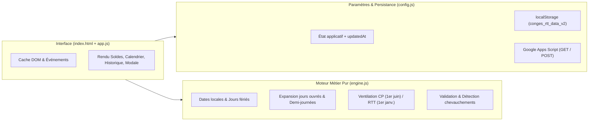

# Architecture — Suivi Congés & RTT (`gestion-conges`)

## 1. Cartographie de l'arborescence

```text
gestion-conges/
├── icons/                      # Icônes PWA (192x192, 512x512)
├── tests/                      # Tests automatisés (Node.js test runner natif)
│   ├── non-regression.test.js  # Snapshot des données réelles & vérification des soldes
│   └── engine.test.js          # Tests unitaires des cas limites (Phase 3)
├── ARCHITECTURE.md             # Cartographie et documentation architecturale
├── index.html                  # Point d'entrée HTML (Dashboard, Calendrier, Modale, Config)
├── input.css                   # Directives source Tailwind CSS & composants UI
├── style.css                   # Feuille de style compilée par Tailwind CLI
├── config.js                   # [Phase 2] Constantes, validation payload, persistance & sync
├── engine.js                   # [Phase 2] Moteur de calcul pur (dates, fériés, soldes, ventilation)
├── app.js                      # Contrôleur UI, événements DOM et rendu
├── sw.js                       # Service Worker (cache offline PWA)
├── manifest.json               # Manifeste Web App (PWA)
├── tailwind.config.js          # Configuration du thème Tailwind CSS
├── eslint.config.js            # Configuration du linter JS
└── package.json                # Scripts et dépendances de développement
```

---

## 2. Séparation des responsabilités (Cible du refactoring)



### 2.1. `config.js` — Paramètres, Validation de schéma & Synchronisation
- Contient les constantes (`GOOGLE_SHEETS_URL`, `STORAGE_KEY`, `TYPES_VALIDES`) et le paramétrage des jours fériés (`DEFAULT_FERIES_OPTIONS`), avec notamment `lundiPentecoteTravaille: true` par défaut (le lundi de Pentecôte étant travaillé au titre de la journée de solidarité, il n'est pas considéré comme férié).
- Valide strictement la structure du payload JSON reçu depuis Google Apps Script (`isValidPayload`) avant tout écrasement.
- Gère l'horodatage `updatedAt` (timestamp ms) et la détection des conflits (`resolveSyncState`) :
  - Les données dépourvues de `updatedAt` sont traitées comme les plus anciennes (`updatedAt = 0`).
  - À chaque mutation locale, `updatedAt` est mis à jour (`Date.now()`) avec `pendingSync: true`.
  - En cas de divergence entre données locales et distantes (par ex. modifications locales non synchronisées ou `local.updatedAt > remote.updatedAt`), **aucun écrasement silencieux n'est effectué** : `resolveSyncState` conserve les données les plus récentes et retourne un état explicite `conflict: true` permettant d'avertir l'utilisateur.

### 2.2. `engine.js` — Logique de calcul pure (sans dépendance DOM)
- **Dates locales** : `parseLocalDate("YYYY-MM-DD")` et `formatLocalDate(date)` évitant tout décalage lié au fuseau UTC.
- **Jours fériés paramétrables** : `getJoursFeries(year, options)` avec cache mémoire, piloté par la configuration de `config.js` (8 fériés fixes + Lundi de Pâques + Ascension ; le Lundi de Pentecôte est exclu des jours fériés lorsque `lundiPentecoteTravaille: true`).
- **Décalage & Expansion des absences** (`expandAbsenceDays(absence)`) :
  - Si la date de début tombe un samedi, dimanche ou jour férié, elle est automatiquement décalée au premier jour ouvré suivant (avec indicateur `shiftedFrom` pour l'aperçu dans la modale).
  - Déroule la durée par pas de `1` ou `0.5` sur les jours ouvrés consécutifs.
  - Rattache **chaque jour ouvré** à sa période effective :
    - **CP** : du 1er juin $N$ au 31 mai $N+1$.
    - **RTT** : du 1er janvier $N$ au 31 décembre $N$.
- **Calcul des soldes** (`calculerSoldes(appData, cpPeriod, rttPeriod)`) :
  - Somme les poids (`1` ou `0.5`) des jours ouvrés ventilés sur la période demandée.
  - Autorise les soldes négatifs et retourne `isNegativeCP` / `isNegativeRTT` pour l'affichage d'alerte.

### 2.3. `app.js` & `index.html` — Interface Utilisateur
- Manipulation du DOM, écouteurs d'événements et rendu visuel.
- Jauge de progression cohérente affichant **Reste / Total**.
- Aperçu temps réel dans la modale (plage réelle couverte, décalage éventuel de début, solde restant après opération).
- Toast d'erreur/information global situé hors de la modale.

---

## 3. Format des données (Inchangé & Rétrocompatible)

```json
{
  "absences": [
    { "id": 1790412079086, "type": "CP", "date": "2026-10-05", "duree": 5 }
  ],
  "configCP": { "2026": 29 },
  "configRTT": { "2026": 12 },
  "configRetraite": {
    "legal": "2040-06-01",
    "anticipe": "",
    "minimized": true
  },
  "updatedAt": 1793543141050
}
```
- Le champ optionnel `updatedAt` est ajouté de manière rétrocompatible sans modifier la structure des tableaux `absences`, `configCP`, `configRTT` et `configRetraite`.

